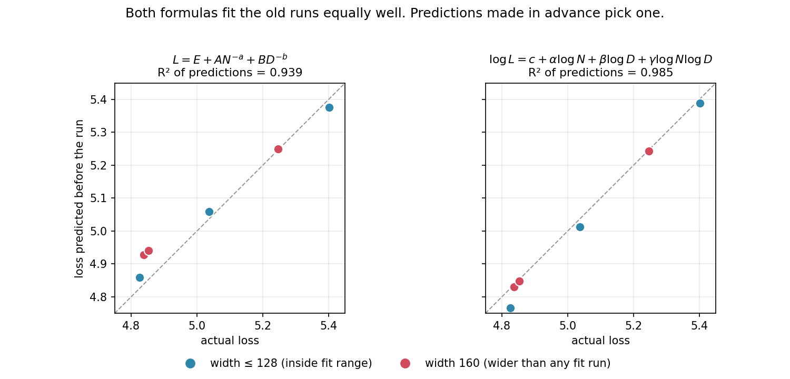

# Training Law Finder

This tool helps you write an AI research paper in 3-5 days.

It works almost autonomously.

You supervise it and talk to it a little.

AI agents do the experiments, the math and the writing.

## Start here

Open Claude Code, Codex or another coding agent in an empty folder, then copy and paste this prompt:

```text
Clone https://github.com/vukrosic/training-law-finder and read README.md, METHOD.md and agents/manager.md.

You are the manager of a research project whose goal is a paper with one new formula about AI training, tested on runs it never saw and on runs predicted before they existed.

Do not run anything yet. First propose 8-10 paper topics, all of them new: none from the README's example table, and none with a published formula you can find. For each topic give one line each on: the number the formula would predict, why a formula might exist, the fastest test on this testbed, and the closest published work and how this differs. Then recommend one and ask me which ideas I like, what I would change or combine, and whether I have an idea of my own. We pick the topic together, then you follow agents/manager.md.
```

The agent will suggest new paper ideas. Pick one with it, then check in every 15 minutes.

## How it works

It is a search for a new formula about AI training, plus a check that the formula is right.

- **Search:** the agents run hundreds of small training runs and try many candidate formulas, for example one that predicts how much a model forgets, or which learning rate is best.
- **Verify:** a formula is kept only if it predicts runs it was never fit on, and runs that did not exist yet when it made its prediction. So the paper reports a rule that holds, not a curve fit to old data.



*Two formulas fit the old runs equally well. Asked to predict 6 new runs in advance, including a model wider than any they were fit on, one formula was clearly better (right).*

## The goal of the paper

One paper, one new formula. The formula predicts a number about training that nobody could predict before, such as how much a model forgets or which learning rate is best, and it is tested on runs it never saw and on runs predicted before they existed. A lab can then use it to set a value without a sweep, or to know the result of a large run from small ones.

The paper makes 3-4 claims:

1. The formula, in one line.
2. How well it predicts runs it was not fit on (score 1).
3. How well its predictions, written before the runs, came true, including runs outside the fit range (score 2).
4. The range where it holds, and where it fails.

## How a project runs

1. **You start it:** "Find a formula about training."
2. **The agent proposes new ideas.** It checks the literature and suggests 8-10 topics, all of them new: none from the table below, and none with a published formula. Each comes with a guess at why a formula might exist and the fastest way to test it.
3. **You talk it through with the agent.** Ask questions, push back, combine two ideas, or add your own. The agent helps you pick the one most worth a paper.
4. **The agents find which settings matter.** They run quick screens over learning rate, schedule, width, data, batch size and more, and drop what has no effect.
5. **They search for the formula.** A formula survives only if it predicts runs it was not fit on (score 1) and runs that didn't exist yet when it made its prediction (score 2).
6. **You check in every 15 minutes.** The agent reports the scores and suggests where to push next; you steer.
7. **They write the paper with you** once a formula scores high on both.

Agent roles and prompts are in [agents/](agents/README.md): manager, ops, theory, sim, writer. The method in full: [METHOD.md](METHOD.md).

## How a formula is judged

Each candidate formula gets two scores, both R² (1.0 = perfect):

- **Score 1, held out:** fit the formula without some runs (for example, all runs of one width), then check how well it predicts the runs it did not see. The score is the worst of these checks.
- **Score 2, predicted in advance:** write the formula's predictions for new runs to a time-stamped file, then run them. The score is how well the predictions came true.

A formula you can trust scores high on both.

## Example topics the agents can pick

Each topic is a number about training that a formula could predict. The agents decide which training settings and measurements go into the formula. These are starting points: the best paper topic is often one that is not on this list.

| Topic | The formula predicts |
|---|---|
| **Loss and scaling** | |
| Final loss | validation loss at the end of training |
| Loss curve | validation loss at every step of training |
| Early stopping guess | final loss, read from the first 10% of the loss curve |
| Compute-optimal size | the model size with the lowest loss for a fixed compute budget |
| Depth vs width | the best ratio of layers to width for a given parameter count |
| Repeated data | loss when training on the same data several times |
| Diminishing returns | the point where more training tokens stop lowering loss |
| Small-to-large transfer | a large model's loss, predicted from small models' runs |
| **Learning rate and schedule** | |
| Best learning rate | the peak learning rate that gives the lowest loss |
| Learning-rate schedule | final loss under any schedule shape |
| Warmup length | the shortest warmup that still trains stably |
| Cooldown length | the best share of training spent decaying the learning rate |
| Schedule switch | loss after the learning rate changes mid-run |
| Learning-rate sensitivity | how much loss rises when the learning rate is off by 2× |
| Restart cost | loss lost when training resumes with a new schedule |
| **Optimizer** | |
| Muon weight decay | the best weight decay for the Muon optimizer |
| Muon vs Adam gap | how much lower Muon's loss is than Adam's at the same compute |
| Momentum | the best momentum value |
| Gradient clipping | the best clipping threshold |
| Update size | how large each weight update is at every step |
| Newton-Schulz steps | how many orthogonalization steps Muon needs |
| Embedding learning rate | the best learning rate for embeddings, relative to hidden layers |
| **Batch size and data** | |
| Critical batch size | the largest batch that still trains efficiently |
| Best batch size | the batch size with the lowest loss for a fixed token budget |
| Batch-size ramp | loss when the batch size grows during training |
| Data mixture | loss on each domain for a given mix of training data |
| Data order | how much the order of training data changes final loss |
| Sequence length | the best training context length for a given budget |
| Noisy data | how much loss rises as a share of the data is corrupted |
| **Memory and facts** | |
| Fact memorization | the share of facts a model can recall |
| Forgetting | how much a model forgets after it stops seeing a fact |
| Memory capacity | how many facts a model can store per parameter |
| Repetitions needed | how many times a fact must be seen before it is recalled |
| Timing of facts | how recall depends on when in training a fact was seen |
| Interference | how much learning new facts erases old ones |
| **Stability** | |
| Loss spikes | the learning rate at which training breaks |
| Divergence time | the step at which an unstable run blows up |
| Attention logit growth | how large attention logits grow during training |
| Weight norm growth | how large the weights grow during training |
| Low-precision safety | whether a run stays stable in 8-bit or 16-bit training |
| **Architecture** | |
| Attention scale | the best attention temperature |
| RoPE base | the best rotary-position base for a given context length |
| Number of heads | the best number of attention heads for a given width |
| MLP width | the best hidden size of the feed-forward layer |
| Residual scale | the best scale for each layer's residual branch |
| Init scale | the best initial weight size per layer type |
| **Mixture of experts** | |
| Number of experts | the best number of experts for a given compute budget |
| Expert load balance | how unevenly tokens spread across experts during training |
| Top-k routing | the best number of experts per token |
| Dense vs MoE gap | how much lower an MoE model's loss is than a dense model's at the same compute |
| **Fine-tuning and RL** | |
| Fine-tuning forgetting | how much pretraining skill is lost during fine-tuning |
| LoRA rank | the smallest LoRA rank that matches full fine-tuning |
| RL reward curve | reward at every step of reinforcement learning |
| KL penalty | the best KL coefficient in RL fine-tuning |
| Distillation gap | how close a small student gets to its teacher |
| **Compression and inference** | |
| Quantization loss | how much loss rises after 4-bit or 8-bit quantization |
| Pruning loss | how much loss rises when a share of weights is removed |
| KV-cache eviction | accuracy when the cache keeps only some tokens |
| Speculative decoding | how many draft tokens get accepted |

> [!NOTE]
> The included testbed covers most loss, learning-rate, optimizer, batch, facts, stability and architecture topics on a laptop. Mixture of experts, fine-tuning, RL and compression topics need your own training script (see below).

## For AI agents reading this repo

If a user pointed you at this repo, start by proposing ideas, not by running the example.

1. Suggest 5 new paper topics that are **not** in the table above. For each, give one line on:
   - the number the formula would predict,
   - why a formula might exist (your guess at the mechanism),
   - the fastest test on this testbed,
   - the closest published work, and how this differs.
2. Say which one you would pick and why.
3. Ask the user to talk it through with you: which ideas sound interesting, what they would change or combine, and whether they have an idea of their own.
4. Once the user agrees on a topic, follow [agents/manager.md](agents/manager.md) from "Starting the project".

## Try it in 2 minutes

```bash
pip install -r requirements.txt
python3 -I testbed/prepare_data.py --vocab 4096        # downloads a ~95 MB FineWeb-Edu shard, ~1 min
python3 testbed/train.py --data data/fineweb_v4096 --d 64 --layers 2 --heads 2 --seq 128 --steps 100
```

The last command trains a tiny language model for about 10 seconds on a laptop CPU and prints one JSON row: its settings, parameter count, tokens seen and validation loss.

If the download fails, download `shard_00000.parquet` from [karpathy/fineweb-edu-100b-shuffle](https://huggingface.co/datasets/karpathy/fineweb-edu-100b-shuffle) yourself and pass it with `--shard /path/to/shard_00000.parquet`.

## The worked example

**Example:** final loss from model size and training length, a small known case that runs end to end on a laptop in 20 minutes: `sh examples/loss-law/run.sh`.

20 training runs (widths 48-128, 100-700 steps), then 6 new runs predicted before they ran, 3 of them at width 160, wider than any fit run.

| Formula | Score 1 (held out) | Score 2 (predicted in advance) |
|---|---|---|
| Sum of two power laws: $L = E + A N^{-a} + B D^{-b}$ | 0.964 | 0.939 |
| Log-linear with interaction: $\log L = c + \alpha \log N + \beta \log D + \gamma \log N \log D$ | 0.963 | **0.985** |

$N$ is non-embedding parameters, $D$ is training tokens, and $E, A, a, B, b, c, \alpha, \beta, \gamma$ are fitted constants. Both formulas fit the old runs equally well, and only the predictions made in advance separate them. The second formula's $\log N \log D$ term captures that wider models gain more from longer training. Details: [examples/loss-law](examples/loss-law/README.md).

## Use it for your own problem

Nothing outside `testbed/` is specific to language models. Give the agents a training script that takes settings as flags and appends one JSON row per run, and they can search for formulas in it: RL agents, image models, robotics simulators.

A result row:

```json
{"tag": "lr0.003_w256", "config": {"lr": 0.003, "width": 256}, "lr": 0.003, "width": 256, "reward": 412.5}
```

A job that runs your script:

```json
{"tag": "lr0.003_w256", "prio": 1, "cmd": "python3 my_rl_train.py --lr 0.003 --width 256 --tag lr0.003_w256 --out results.jsonl"}
```

Run the jobs, then fit and score a formula:

```bash
python3 queue/run_jobs.py jobs.jsonl --results results.jsonl --par 2
python3 fit/laws.py results.jsonl --y reward --vars LR=lr W=width \
    --terms "log(LR)" "log(W)" "log(LR)**2" --holdout config.width
```

## What is inside

| Folder | What it holds |
|---|---|
| [agents/](agents/README.md) | Prompts for the manager, ops, theory, sim and writer sessions, the orders template, and the 15-minute check |
| [testbed/](testbed/) | `train.py`: a small modern transformer (RMSNorm, RoPE, QK-norm, SwiGLU), Muon for hidden matrices and Adam for the rest, cosine / constant / warmup-stable-decay schedules, every setting a flag, one JSON row out. `facts.py`: made-up people with five facts each, mixed into training at chosen counts, with per-person recall. `prepare_data.py`: FineWeb-Edu shard and BPE tokenizer |
| [queue/](queue/) | `run_jobs.py` runs a job file a few jobs at a time and skips jobs that already finished; `status.py` prints a one-screen status |
| [fit/](fit/) | `laws.py` fits formulas and computes score 1, with a gradient-boosted-tree baseline for comparison; `prereg.py` writes predictions before runs and computes score 2 |
| [skill/](skill/writing-conference-paper/SKILL.md) | A paper-writing skill for coding agents: one finding, simple writing, controls, gates |
| [examples/loss-law/](examples/loss-law/README.md) | The worked example with its results and chart |

> [!NOTE]
> The testbed is small on purpose: widths of tens to a few hundred and a few thousand steps fit on a laptop or one GPU. A formula found here holds for that range; state the range in any paper.

## Data

FineWeb-Edu (ODC-By), `shard_00000.parquet` of `karpathy/fineweb-edu-100b-shuffle` on Hugging Face, pinned to one revision. Documents 0-511 are validation, the rest training.

## License

MIT
