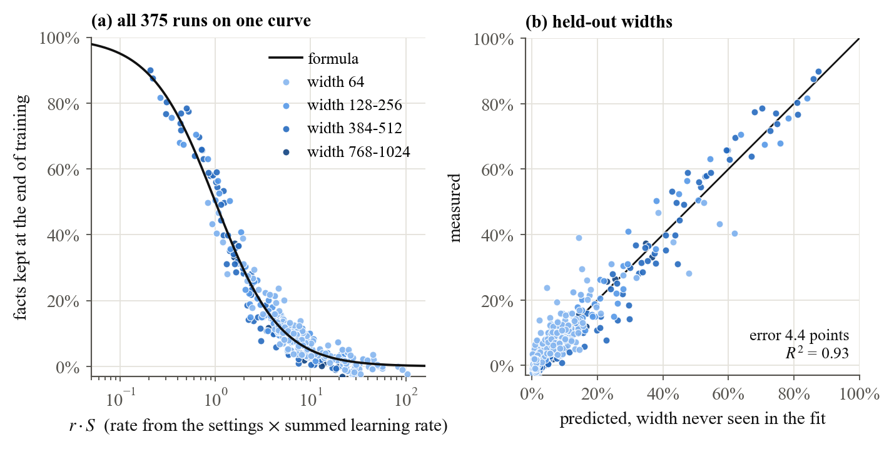

AI draft, not checked by a person.

# Rules for How Language Models Forget Facts During Training

Vuk Rosić, 27 November 2026

**PDF:** [zenodo.org/records/24575890](https://zenodo.org/records/24575890) ·
**DOI:** [10.5281/zenodo.24575889](https://doi.org/10.5281/zenodo.24575889)

## Abstract

We give seven rules for how a small language model forgets facts it stops seeing during training, each with a label for how sure we are. They come from 375 transformers (0.12M to 126M parameters) trained with Muon, with made-up facts shown in one window of each run. The main rule: facts fade with S, the learning rate summed over the steps after the facts, not with the number of steps. So lowering the learning rate after the facts keeps the most: a cosine schedule keeps 29% where a constant one keeps 2%. One formula, kept = 1/(1 + (rS)^q), turns the rules into a prediction made before training. For model widths it never saw, it is off by 4.4 percentage points, and the error does not grow with model size across a 1,000-fold range. Its one test beyond that range, a 503M-parameter model, was committed before the result: 24.1% predicted, 24.2% measured. The runs, formula and code are public, so the ten constants can be refitted to larger models. Repeated facts and other optimizers are not tested.



**Figure 1.** One formula for all 375 runs. Each dot is one training run. (a) The share of facts kept at the end of training against r·S; the line is the formula. (b) Measured against predicted, where each run is predicted by constants fitted without any run of its model width.

## Cite

```bibtex
@misc{rosic2026forgetting,
  author    = {Rosi{\'c}, Vuk},
  title     = {Rules for How Language Models Forget Facts During Training},
  year      = {2026},
  month     = nov,
  publisher = {Zenodo},
  doi       = {10.5281/zenodo.24575889},
  url       = {https://doi.org/10.5281/zenodo.24575889}
}
```

## What is here

| file | what |
|---|---|
| [paper.tex](paper.tex) | the text, ICML two-column style ([icml2026.sty](icml2026.sty)) |
| [figures/](figures/) | the six figures as PNG |
| [paper_numbers.py](paper_numbers.py) | computes every number in the text from the public table |
| [make_figs.py](make_figs.py) | draws the six figures |
| [reproduce.sh](reproduce.sh) | runs all of the above, no training |

```text
sh drafts/forgetting-rules/reproduce.sh
```

## Problem and formula

- Problem and scoring: [problems/forgetting](../../problems/forgetting/), 375 runs
- The paper's formula: [end_z2.py](../../problems/forgetting/formulas/end_z2.py), ten constants, 0.0441 on held-out widths
- The prediction committed before the 503M run: [rounds/002-forgetting](../../rounds/002-forgetting/)
- Future work (repeated facts, the cause, other optimizers) is Table 3 of the paper. Each row can be run and sent as a pull request.
