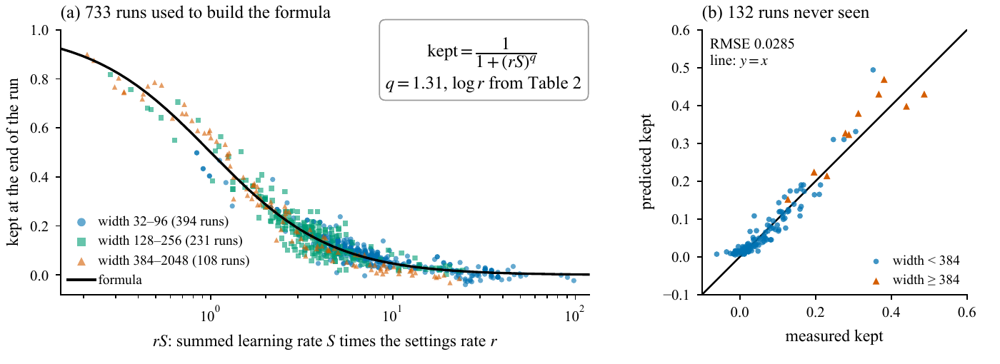

# A Rough Formula for Forgetting Facts in LLM Pretraining

Vuk Rosić, November 2026

**PDF:** [forgetting-formula.pdf](https://huggingface.co/datasets/vukrosic/training-laws-research/blob/main/papers/forgetting-formula.pdf)

## Abstract

Facts a model sees in only one short stretch of pretraining fade with the learning rate spent afterwards, not with the number of steps. Across models from 0.25M to 128M parameters, one shared curve per model size explains 85–93% of the variance in how much is kept when plotted against S, the learning rate summed since the facts last appeared, and 42–73% when plotted against steps. The curve kept = 1/(1 + (rS)^q ), with log r linear in ten settings known before training, predicts the end of 132 runs it never saw with error 0.029 in kept units, where two runs with identical settings differ by 0.013. To control exactly when the facts appear, we use synthetic biographies of made-up people, as in Allen-Zhu and Li (2023) and Chang et al. (2024). We tested synthetic biography facts and one small test with real Python code, on small models with the Muon optimizer; whether other real facts and data at larger scale follow the same rule is open. 

**Figure 1.** Left: 733 runs used to build the formula, kept against r·S. Right: predicted against measured kept for 132 runs the formula never saw (error 0.029).

## The formula

kept = 1 / (1 + (r·S)^q)

- kept: share of the facts the model still knows at the end (1 = all, 0 = none)
- S: the learning rate summed over every step after the model last saw the facts
- r: how fast this model forgets, from settings known before training (model size, batch size, weight decay, schedule, when the facts appeared)
- q: how sharp the drop is, fit once from the data

## Data, code and open tests

- Problem and scoring: [problems/forgetting](../../problems/forgetting/), formula files [hA.py](../../problems/forgetting/formulas/hA.py) and [a_hA.py](../../problems/forgetting/formulas/a_hA.py)
- Predictions made before the runs exist: [rounds/002-forgetting](../../rounds/002-forgetting/)
- All runs: [vukrosic/training-laws-research](https://huggingface.co/datasets/vukrosic/training-laws-research) on Hugging Face
- Open tests (bigger models, real data at scale) are listed in Section 8 of the PDF. Help with runs on bigger models is welcome.
